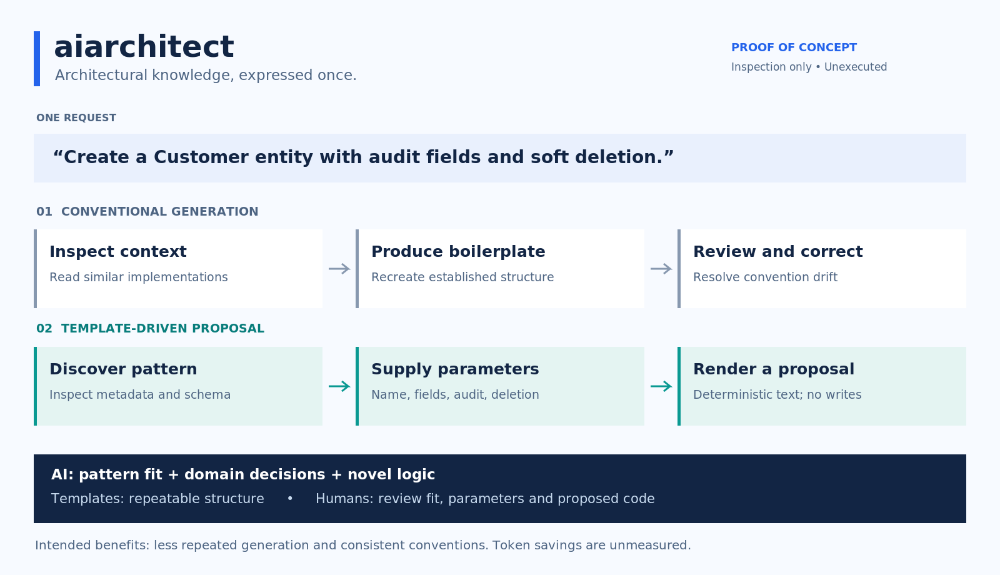

#  aiarchitect

**Don't pay for AI to reinvent the wheel. Let your agent cut token costs with a library of parameterised templates.**



> Disclaimer: Proof of Concept — inspection only
>
> Do not run, install, build, deploy, or otherwise execute anything from this repository. This includes the CLI, example applications, bootstrap scripts, container configurations, editor tasks and automation workflows. The repository is provided for reading and architectural discussion only.
>
> Much of this project was built with AI-Assisted Development workflows for demonstrating and testing logic. That describes its exploratory purpose; it does not establish that the code or its logic has been tested, independently reviewed, or verified. Treat all code, configuration, documentation and outputs as untrusted illustrative material. Do not rely on them for correctness, security, reliability or deployment decisions, even if a check reports success.
>
> This project has a shallow Git history because it is based on proprietary codebases that could not be cloned into this public repository. The GitHub version is provided for illustrative purposes only and does not include the original codebases or their development histories. Here, “shallow history” describes the limited public development record, not a Git shallow-clone configuration.
>
> It is not actively maintained and is not intended for production use. Features, configuration formats, APIs and command-line interfaces may change without notice. No guarantees are provided regarding stability, security, compatibility or ongoing support.

**Experimental, unfinished Python 3 proof of concept. Source-available for inspection, not open source.** The tagline describes an intended benefit: token savings have not been measured.

## Architectural knowledge, expressed once

In a large monorepo, a request as small as “add a Customer entity” can require an agent to inspect domain conventions, repository interfaces, audit fields, error handling and existing tests. The agent then spends output tokens reproducing much of what those files already establish. Small deviations create review work and architectural drift.

`aiarchitect` explores a different division of labour: **use AI for decisions and novel business logic; use deterministic templates for established architecture.** A repository-local catalogue records when a pattern applies, its parameters, its proposed files and the conventions it captures. An agent discovers a pattern, selects domain parameters and asks for a proposal. A developer still needs to assess the result.

This is infrastructure for AI coding agents, not another general-purpose AI agent. No model, AI API, credentials, database or external service is involved in the illustrative design.

## Before and after

| Stage | Conventional agent generation | Template-driven proposal |
|---|---|---|
| Learn conventions | Inspect several similar implementations | Discover metadata; inspect the selected schema and templates |
| Make domain decisions | Infer names, types and behaviour | Supply a compact parameter payload |
| Produce structure | Generate boilerplate token by token | Render versioned architectural templates |
| Review | Check conventions and business logic | Check pattern fit, parameters, template quality and business logic |

Discovery and template maintenance have costs too. A small one-off task or a well-cached agent may gain little. Templates are most plausible where conventions recur and are stable enough to encode.

## Worked example: Customer entity

Request: “Create a Customer database entity containing a name, email address and registration date, with audit fields and soft deletion.”

The agent selects `database.entity` and proposes the following payload, also recorded in [examples/customer-entity.json](examples/customer-entity.json):

```json
{
  "name": "Customer",
  "fields": [
    { "name": "name", "type": "string", "required": true },
    { "name": "email", "type": "string", "required": true },
    { "name": "registeredAt", "type": "datetime" }
  ],
  "auditable": true,
  "softDelete": true
}
```

The proposed file is `customer.entity.ts`. Its manually authored, unexecuted [sample output](examples/generated/customer.entity.ts) illustrates:

```typescript
export interface Customer {
  id: string; // UUID supplied by the persistence boundary
  name: string;
  email: string;
  registeredAt?: Date;
  createdAt: Date;
  updatedAt: Date;
  deletedAt: Date | null;
}
```

Here `datetime` maps to `Date`; omitted `required` means optional. UUID allocation, timestamp updates and soft-delete query semantics remain persistence responsibilities. An interface alone does not enforce them. The PoC does not implement a repository adapter, migrations or email validation.

## Architecture and boundaries

**Discover → Describe → Parameterise → Validate → Generate a proposal → Human review**

| Component | Responsibility | Illustrative source |
|---|---|---|
| Catalogue | Read local definitions; match IDs, descriptions and tags | [catalogue.py](src/aiarchitect/catalogue.py) |
| Models | Represent patterns, template definitions and proposed files | [models.py](src/aiarchitect/models.py) |
| Validation | Separate definition errors from invalid parameters | [validation.py](src/aiarchitect/validation.py) |
| Renderer | Expand explicit templates with strict variables in a Jinja sandbox | [renderer.py](src/aiarchitect/renderer.py) |
| Planner | Check destinations, duplicate paths and existing-file conflicts | [planner.py](src/aiarchitect/planner.py) |
| CLI | Expose catalogue, validation and preview concepts | [cli.py](src/aiarchitect/cli.py) |

The planner returns in-memory `GeneratedFile` objects. It does not write generated files. Rendering and output-path validation are separate so conflicts can stop the whole proposal before it is presented. `generate` conceptually returns JSON containing paths and contents, not an applied change.

Path checks reject traversal, absolute paths, backslashes, symlink escapes and duplicate destinations. These are illustrative checks, not a security guarantee. Sandboxing limits template access but does not bound CPU, memory or output size. Pattern definitions and templates require review; see [architecture and trust boundaries](docs/architecture.md).

## Pattern catalogue

| Pattern | What it captures | Deliberate boundary |
|---|---|---|
| `database.entity` | UUID-shaped identifier, field mapping, audit timestamps, soft-delete field | No ORM, repository or runtime validation |
| `cqrs.command` | Command payload, handler and optional transaction boundary | Registration rules, persistence and transaction implementation are extension points |
| `project.module` | Domain/application/infrastructure/presentation/test boundaries, static TypeScript configuration and dependency metadata | No functioning application or dependency resolution |
| UI form, API, service, messaging | Potential additional catalogue entries | Not implemented |

The CQRS example goes beyond scaffolding: the handler places the business operation inside an explicit transaction abstraction when requested. The generated extension point throws until domain logic is supplied; it cannot silently report success. See [pattern contracts](docs/patterns.md) and [RegisterCustomer parameters](examples/create-customer-command.json).

## Proposed agent interface

These are **illustrative interface signatures, not execution instructions**. Do not run them.

| Signature | Proposed response |
|---|---|
| `aia list` | Pattern metadata |
| `aia search <query>` | Case-insensitive keyword matches |
| `aia describe <id>` | Metadata, schema and output declarations |
| `aia validate <id> --params <file>` | Parameter diagnostics |
| `aia generate <id> --params <file> --output-root <directory>` | JSON proposal; no file writes |

The Python sketch contains these five command branches. There is no installed command entry point, interactive agent, MCP server, write/apply command, architecture checker or migration engine. `init`, `check` and `explain` in the reference poster are outside this iteration. The `aia` name is a proposed interface only. [Agent integration](docs/agent-integration.md) describes the contract without an execution walkthrough.

## Token economics: a hypothesis

Templates aim to replace repeated context inspection and boilerplate output with discovery and parameter submission. Actual savings depend on catalogue size, schema verbosity, cache behaviour, template complexity and remaining novel logic. Generated source returned to an agent can itself consume context; a future integration could return a manifest and selectively disclose contents.

No benchmark has been executed and no cost, speed or correctness improvement is established.

| Metric | Conventional AI | aiarchitect |
|---|---|---|
| Input tokens | To measure | To measure |
| Output tokens | To measure | To measure |
| Total API cost | To measure | To measure |
| Tool calls | To measure | To measure |
| Completion time | To measure | To measure |
| Test pass rate | To measure | To measure |
| Architectural violations | To measure | To measure |
| Manual corrections | To measure | To measure |

A future study would pair identical tasks and quality criteria, account for cold and warm caches, include template-authoring overhead, and report failed attempts as well as successes. [Benchmark design](docs/benchmarks.md) specifies the proposed comparison; it is not an invitation to execute this repository.

## Design decisions and trade-offs

- **Local, declarative catalogue:** keeps architectural knowledge near the code, with simple keyword discovery instead of embeddings. Matching is intentionally limited and does not prove that a pattern fits a request.
- **JSON Schema at the boundary:** makes types, required parameters and permitted values visible. A small semantic check additionally rejects duplicate or reserved entity fields. Neither establishes domain correctness.
- **Jinja2 with strict undefined variables:** makes missing context explicit. Template authors still control generated source and need review. Parameter schemas restrict the examples to simple identifiers and known types.
- **Explicit version and output declarations:** make change impact inspectable. Version numbers are metadata; pinning, compatibility checks and migrations are unfinished.
- **Preview-only planning:** separates a proposed change from mutation. A future apply phase would need atomic writes, race protection, overwrite policy and recovery.
- **Small Python package:** separates responsibilities without services or framework machinery. TypeScript is an illustrative output language, not a second executable application.

## Repository map

```text
README.md                 Architectural narrative and worked example
LICENSE                   All rights reserved
assets/                   Architecture diagram (PNG and editable SVG)
docs/                     Design, integration, benchmarks and limitations
src/aiarchitect/          Illustrative Python modules
patterns/                 Three YAML definitions, JSON schemas and Jinja templates
examples/                 Static payloads and manually authored sample outputs
tests/                    Unexecuted illustrative test cases
pyproject.toml            Descriptive package and dependency metadata
```

## Limitations and possible next steps

This is deliberately unfinished. No code, sample tests or generated outputs have been executed or independently verified for this deliverable. There is no resource isolation, secure ingestion of hostile patterns, composition, migration, rollback, real repository adapter or complete TypeScript toolchain. Tests describe intended behaviour; their presence is not evidence of passing checks. See [limitations](docs/limitations.md).

Potential extensions, not commitments:

1. **Basic PoC:** refine discovery, validation, rendering, preview planning and examples.
2. **Agent integration:** skills, MCP tools and progressive disclosure of selected schemas.
3. **Architectural composition:** explicit dependencies between patterns and conflict handling.
4. **Governance:** version pinning, architectural checks and migration proposals.
5. **Measurement:** controlled comparisons with independently assessed quality gates.

## Copyright

Copyright (c) 2026. All rights reserved. This repository is **source-available for inspection, not open source**. No permission to use, copy, modify, distribute, sublicense or create derivative works is granted without prior written permission from the copyright holder. See [LICENSE](LICENSE).
